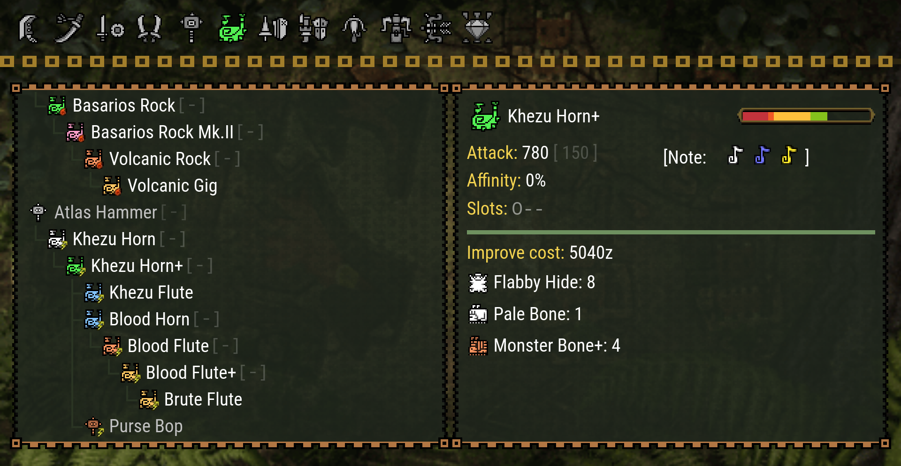

# MHFU - Blacksmith

[](https://app.netlify.com/sites/mhfu-blacksmith/deploys)

Detailed weapon trees, armor lists, and monster information for Monster Hunter Freedom Unite / P2G in the style of the in-game UI!



## Credits

Thank you to all the people below, and anyone I missed, for the invaluable help with this project:

- Aino
- Arxx
- Assis
- Athena
- Danzell
- Darkcola
- Emanon
- Hay_AJ
- Hunsterverse contributors
- Ice Cream
- Jely
- kpworthi
- kushala
- lirkas
- Mustard
- rafaellum
- Shiro
- Vid (Firaga)
- WillTheHunter
- Yaas
- Zack

## Development

The site is a statically exported [Next.js](https://nextjs.org/) app.

Dependencies:

- [Node.js](https://nodejs.org/) 22+
- [pnpm](https://pnpm.io/) (version pinned in `package.json`; `corepack enable` will pick it up)
- [Ruby](https://www.ruby-lang.org/) (version in `.ruby-version`, then `bundle install`; only for `pnpm generate-maps` and `pnpm validate-schema`)
- [ImageMagick](https://imagemagick.org/) (optional, for `scripts/crop-images.sh`)

```sh
pnpm install

# Generate the client data bundles in public/ (needed once before `pnpm dev`,
# and again whenever data/ or content/ changes)
pnpm generate-data && pnpm generate-search && pnpm generate-weapons

pnpm dev       # local dev server on http://localhost:3000
pnpm build     # regenerate data + static export to out/
pnpm lint      # ESLint
pnpm validate  # sanity-check data/ and content/
pnpm validate-schema  # check data/ against data/schemas/ (Ruby)
```

Source data lives in `data/` (items, validated by `data/schemas/`) and `content/` (crafting trees). Generated files under `public/data`, `public/*.json` and `out/` are git-ignored.

The crafting trees in `content/**/map.json` are generated from `data/` with `pnpm generate-maps`. Rerun it after adding or re-parenting weapons, armor, or decorations.

`data/equipment-ids.json` maps the game's equipment IDs (the ones stored in a save file's equipment box) to the weapons and armor in `data/`. It is generated with `pnpm generate-equipment-ids` from the `equip.enum` name tables in [IncognitoMan/mhp2g-patterns](https://github.com/IncognitoMan/mhp2g-patterns) (MIT, vendored under `tools/mhfu-extract/vendor/`), plus the hand-checked aliases in `scripts/equipment-id-aliases.json` for names that differ between MHP2G and MHFU. Rerun it after renaming or adding weapons or armor; `pnpm validate` fails if it's stale.

`data/item-ids.json` does the same for items: it maps the material names used in recipes to the game's item IDs (from the same project's `items.enum`), so the hunter page can check upgrades against a save's item box. Generate it with `pnpm generate-item-ids`; aliases and deliberately unmapped names live in `scripts/item-id-aliases.json`.

The site is deployed by [Netlify](https://app.netlify.com/sites/mhfu-blacksmith/deploys), which builds `main` for production and every pull request as a deploy preview.
