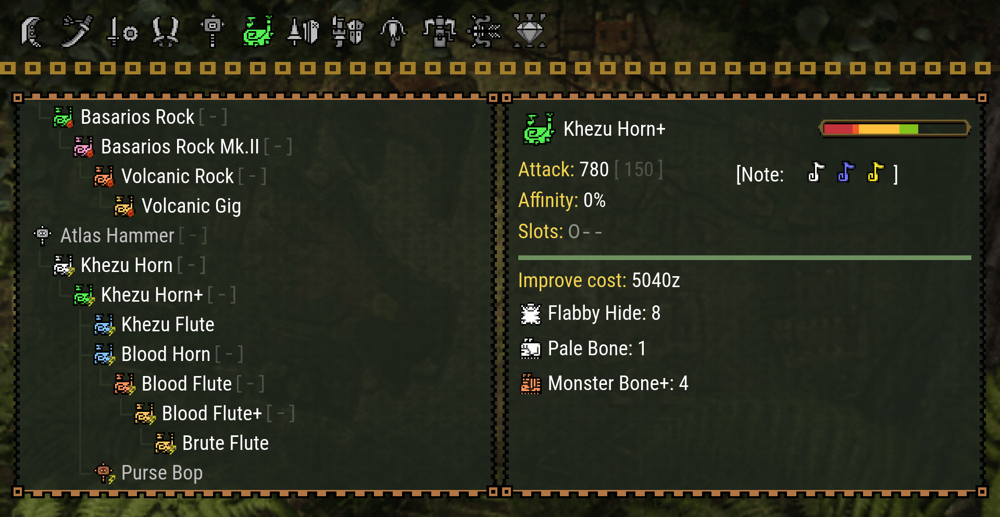

# MHFU - Blacksmith

Detailed weapon trees, armor lists, and monster information for Monster Hunter Freedom Unite / P2G in the style of the in-game UI!



## Credits

Thank you to all the people below, and anyone I missed, for the invaluable help with this project:

- Aino
- Arxx
- Assis
- Athena
- Danzell
- Darkcola
- Emanon
- Hay_AJ
- Hunsterverse contributors
- Ice Cream
- Jely
- kpworthi
- kushala
- lirkas
- Mustard
- rafaellum
- Shiro
- Vid (Firaga)
- WillTheHunter
- Yaas
- Zack

In-game item IDs and names (`data/mhfu/items.json`, used by the save loader on `/hunter`) were imported once from the MIT-licensed datamines [Daigo829/mhfu-save-viewer](https://github.com/Daigo829/mhfu-save-viewer) and [IncognitoMan/mhp2g-patterns](https://github.com/IncognitoMan/mhp2g-patterns), and are edited by hand since. Each item's rarity, carry limit and price come from the disc (`packages/mhfu-extract`).

The skill activation table (`data/mhfu/skills.json`, used by the set builder on `/set-builder`) comes from the MIT-licensed [Kolyn090/mhfu-db](https://github.com/Kolyn090/mhfu-db) (Kolyn090, Gustavo Augustini), with tree names changed to the game's `SkillID` spelling and the site's other spellings listed as `aliases`. The set builder itself is modelled on Athena's Armor Set Search.

## Repository layout

This is a [pnpm workspace](https://pnpm.io/workspaces):

| Path                    | Package        | What it is                                                                                      |
| ----------------------- | -------------- | ----------------------------------------------------------------------------------------------- |
| `apps/blacksmith`       | `blacksmith`   | The MHFU Blacksmith website, a statically exported [Next.js](https://nextjs.org/) app           |
| `apps/randomfu`         | `randomfu-web` | The randomizer as a static web app that runs in the browser, at randomfu.vallode.com            |
| `packages/mhfu-extract` | `mhfu-extract` | Datamining pipeline: reads a disc image and emits `data/` and the site's 3D models              |
| `packages/randomfu`     | `randomfu`     | The seeded randomizer behind `apps/randomfu`: options, shuffles, disc patching, spoiler log     |
| `packages/game-data`    | `game-data`    | The one way into `data/`: `readData` for everything that reads it, `writeData` for writing      |
| `data`                  |                | The game data the site is built from (JSON, validated by `data/schemas/`), shared by everything |

Packages import each other by name (`import … from "mhfu-extract/src/container/image.js"`),
declared as `workspace:*` dependencies.

## Development

Dependencies:

- [Node.js](https://nodejs.org/) 22+
- [pnpm](https://pnpm.io/) (version pinned in `package.json`; `corepack enable` will pick it up)

From the repository root:

```sh
pnpm install

pnpm dev            # the site's dev server on http://localhost:3000
pnpm build          # regenerate the site's data + static export to apps/blacksmith/out/
pnpm lint           # ESLint
pnpm typecheck      # tsc in every package
pnpm test           # every package's tests
pnpm format         # Prettier, for the whole repository
pnpm format:check   # Prettier, check only
pnpm link:cache     # link this worktree to the main checkout's datamining cache
pnpm clean:discs    # delete disc images left in Claude Code scratchpads (--dry-run lists them)
```

Run any package's own scripts with `pnpm --filter <package> <script>`.
More: [the site's workflow](apps/blacksmith/README.md) (data, crafting trees,
3D models), [the game data format](packages/game-data/README.md) and
[deployment](docs/deploying.md) (Cloudflare).
